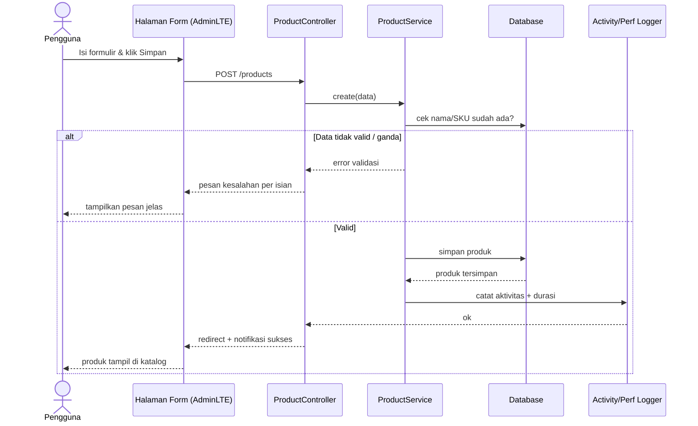
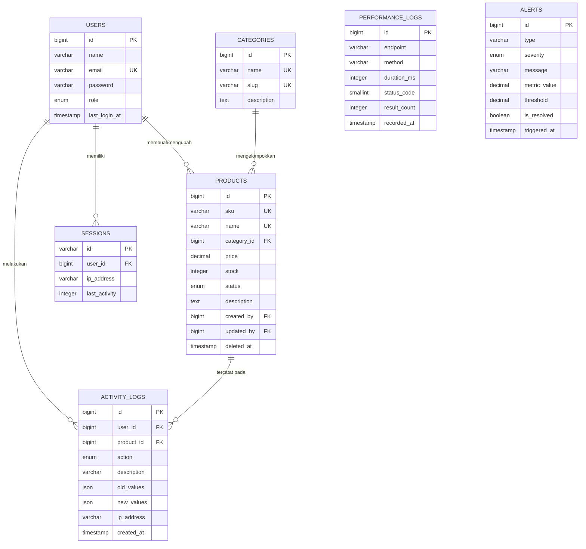

# PRD — Project Requirements Document

## 1. Overview

Perusahaan digital ini menyimpan data produk di banyak tempat (spreadsheet, catatan tim, file pribadi), sehingga data mudah basi, sulit dicari, dan tidak ada catatan siapa mengubah apa. Tim teknis juga sering diminta bantuan hanya untuk menambah atau mengubah satu produk.

**Product Management Service** adalah modul internal berbentuk prototype yang menjadi satu pintu untuk mengelola data produk: melihat katalog, menambah/mengubah/menghapus produk, mencari dengan cepat, dengan isian yang tervalidasi, aktivitas yang tercatat, kondisi performa yang bisa dipantau, dan dokumentasi yang lengkap untuk pengguna maupun tim teknis.

**Tujuan utama:**

| Tujuan | Ukuran keberhasilan |
|---|---|
| Data produk rapi di satu tempat | Seluruh produk tampil di satu tabel dan bisa dicari |
| Tim non-teknis bisa mandiri | Menambah/mengubah produk < 1 menit tanpa bantuan teknis |
| Data tidak kotor | 0 data kosong/ganda tersimpan; pesan kesalahan jelas |
| Perubahan bisa dilacak | 100% operasi tambah/ubah/hapus tercatat di catatan aktivitas |
| Kualitas terbukti | Laporan pengujian integrasi, sistem, dan stress tersedia di folder `docs` |
| Masalah kecil ketahuan lebih awal | Peringatan otomatis muncul saat ambang batas kesalahan/kecepatan terlampaui |

**Yang membuat modul ini dipakai berulang:** data tersimpan rapi dan riwayat perubahannya bisa dipercaya, sehingga pengguna kembali karena merasa aman — bukan karena terpaksa.

---

## 2. Requirements

**Ruang lingkup & batasan**
- Berupa prototype sederhana (bukan aplikasi produksi skala penuh), dibangun dengan Laravel 13 + Bootstrap + template AdminLTE v4.
- Modul berjalan sebagai aplikasi internal; akses dibuka setelah pengguna masuk (login), sesuai kebiasaan "login dulu" sebelum bekerja.
- Fokus pada satu domain: produk (beserta kategori sebagai pengelompok) — tidak mencakup transaksi penjualan, pembayaran, atau integrasi pihak ketiga.
- Seluruh kode dikelola dengan versioning (Git) dan melalui code review sebelum digabung.

**Kebutuhan fungsional utama**
- Pengelolaan data produk (tambah, lihat, ubah, hapus) dengan algoritma CRUD yang jelas dan aman.
- Pencarian produk dengan kata kunci, filter kategori/status, dan pengurutan hasil.
- Validasi isian di sisi server dan tampilan, termasuk pencegahan nama produk ganda.
- Logging aktivitas pada operasi penting: login, logout, tambah, ubah, hapus, pencarian gagal/error.
- Pemantauan sederhana: durasi proses, jumlah kesalahan, dan notifikasi/alert berdasarkan ambang batas yang ditentukan.
- Dokumentasi teknis, dokumentasi pengguna, dan laporan pengujian dalam folder `docs`.

**Kebutuhan non-fungsional**
- **Kemudahan pakai:** alur 3–4 klik untuk menyelesaikan satu tugas; label berbahasa Indonesia; pesan kesalahan menunjuk isian yang salah.
- **Performa:** pencarian pada 10.000 baris data selesai < 300 ms; halaman katalog tampil < 2 detik pada data normal.
- **Keamanan:** wajib login, sesi berakhir otomatis saat idle, proteksi CSRF, password ter-hash, hak akses terbatas pada pengguna berwenang.
- **Keterlacakan:** setiap perubahan produk menyimpan nilai lama dan nilai baru serta pelakunya.
- **Keterpeliharaan:** struktur kode berprinsip OOP (Controller–Service–Model terpisah), mudah dibaca, dan diberi komentar pada logika penting.

**Kebutuhan pengujian & kualitas**
- Pengujian integrasi: CRUD, pencarian, dan validasi bekerja bersama database dan lapisan service.
- Pengujian sistem: skenario penggunaan end-to-end (login → tambah → cari → ubah → hapus → cek catatan aktivitas).
- Pengujian stress: pencarian dan daftar produk dengan volume data besar (mis. 10.000–50.000 baris) dan permintaan berulang/paralel.
- Debugging dan perbaikan berdasarkan temuan, lalu pengujian ulang hingga lolos.
- Code review terhadap hasil implementasi (checklist: konsistensi gaya, penanganan error, keamanan, cakupan pengujian).
- Log monitoring untuk menganalisis perilaku modul, dilanjutkan evaluasi performa.

**Deliverable dokumentasi (folder `docs`, format .docx)**
- `01-dokumentasi-teknis.docx` — desain, arsitektur, struktur data, alur fungsi.
- `02-dokumentasi-pengguna.docx` — panduan langkah demi langkah untuk pengguna harian.
- `03-laporan-pengujian.docx` — hasil dan kesimpulan pengujian integrasi, sistem, dan stress, termasuk temuan & perbaikannya.

**Versioning**
- Repositori Git dengan alur branch `main` (stabil) dan `feature/*` (pekerjaan).
- Penomoran versi semantik: `v0.1.0` (kerangka + katalog), `v0.2.0` (kelola + pencarian), `v0.3.0` (keamanan + catatan aktivitas), `v1.0.0` (pemantauan + dokumentasi lengkap).
- Setiap perubahan besar disertai pesan commit yang jelas dan melalui review.

---

## 3. Core Features

### Fase 1 — Katalog & Kelola Produk

**Katalog Produk** — Halaman utama yang menampilkan seluruh data produk dalam satu tabel agar mudah dilihat sekilas.
- **Tabel Produk** — Menampilkan nama, kategori, harga, dan stok dalam satu tampilan dengan pagination agar tetap ringan.
- **Detail Produk** — Membuka satu produk (mode baca) untuk melihat informasi lengkap tanpa risiko mengubah data.
- **Ringkasan Jumlah** — Angka cepat jumlah produk tersimpan (total, per kategori, stok menipis) di bagian atas halaman.

**Kelola Produk** — Menambah, mengubah, dan menghapus produk langsung dari aplikasi tanpa bantuan tim teknis.
- **Tambah Produk** — Formulir singkat (nama, kategori, harga, stok, deskripsi) untuk memasukkan produk baru; tersimpan setelah validasi lolos dan tercatat di log.
- **Ubah Produk** — Memperbarui informasi produk yang sudah ada; nilai lama disimpan di catatan aktivitas sebagai pembanding.
- **Hapus Produk** — Menghapus produk dengan dialog konfirmasi; penghapusan lunak (data masih bisa ditelusuri) dan tercatat di log.

### Fase 2 — Pencarian & Validasi

**Pencarian Produk** — Menemukan produk tertentu dengan cepat tanpa menggulir seluruh daftar.
- **Pencarian Cepat** — Mengetik kata kunci nama (atau SKU) dan hasil langsung tampil.
- **Filter Kategori** — Mempersempit daftar berdasarkan kategori atau status (aktif/nonaktif/stok habis).
- **Urutkan Hasil** — Mengurutkan hasil berdasarkan nama, harga, atau terbaru.
- **Hasil Kosong** — Penjelasan ramah saat produk tidak ditemukan, disertai saran memperlebar kata kunci atau menghapus filter.

**Validasi Isian** — Mencegah data produk yang salah atau kosong tersimpan ke dalam sistem.
- **Pemeriksaan Formulir** — Pemeriksaan wajib isi, tipe angka untuk harga/stok, nilai tidak negatif, panjang maksimum teks — dijalankan di server dan ditampilkan di form.
- **Pesan Kesalahan Jelas** — Keterangan sederhana tepat di bawah isian yang bermasalah, bukan pesan teknis.
- **Cegah Data Ganda** — Peringatan bila nama produk (atau SKU) yang sama sudah tersimpan, dengan tautan ke produk yang sudah ada.

### Fase 3 — Keamanan & Catatan Aktivitas

**Masuk & Keamanan** — Membatasi akses modul hanya untuk pengguna yang berhak mengelolanya.
- **Halaman Login** — Pengguna masuk dengan akun kantornya sebelum membuka modul; percobaan gagal dicatat.
- **Keluar Akun** — Mengakhiri sesi dengan aman, terutama saat memakai komputer bersama.
- **Sesi Berakhir** — Aplikasi otomatis meminta masuk ulang bila dibiarkan terbuka terlalu lama (idle timeout).

**Catatan Aktivitas** — Merekam siapa mengubah produk apa dan kapan, sehingga data tetap rapi dan bisa dilacak.
- **Riwayat Perubahan** — Daftar kegiatan tambah, ubah, hapus (serta login/logout) beserta waktu dan pelakunya.
- **Detail Aktivitas** — Membuka satu catatan untuk melihat rincian perubahan: isian mana yang berubah, dari nilai lama ke nilai baru.
- **Saring Riwayat** — Menyaring catatan berdasarkan jenis kegiatan, produk, atau rentang tanggal.

### Fase 4 — Pemantauan & Dokumentasi

**Pantau Performa** — Menunjukkan kondisi kesehatan modul agar masalah kecil ketahuan lebih awal.
- **Ringkasan Kinerja** — Gambaran harian: jumlah operasi, rata-rata durasi, jumlah kesalahan, pencarian tercepat/terlambat.
- **Kecepatan Pencarian** — Catatan waktu tiap pencarian sehingga dampak pertumbuhan data bisa dilihat.
- **Peringatan Otomatis** — Notifikasi di dashboard (dan/atau email) saat kondisi tertentu terdeteksi, mis. > 5 kesalahan dalam 15 menit, pencarian > 500 ms, atau > 10 login gagal berturut-turut.

**Dokumentasi & Panduan** — Menyediakan penjelasan cara pakai dan catatan teknis modul dalam satu tempat.
- **Panduan Pengguna** — Langkah-langkah sederhana memakai modul untuk pengguna sehari-hari (versi .docx di `docs` dan halaman bantuan di aplikasi).
- **Dokumentasi Teknis** — Penjelasan desain, arsitektur, struktur data, dan alur fungsi untuk tim teknis.
- **Laporan Pengujian** — Rangkuman hasil pengujian integrasi, sistem, dan stress sebagai bukti kualitas, lengkap dengan temuan dan perbaikannya.

---

## 4. User Flow

**A. Masuk & melihat katalog (Fase 1 & 3)**
1. Pengguna membuka alamat aplikasi → diarahkan ke halaman Login.
2. Mengisi email & password → sistem memeriksa akun dan mencatat aktivitas login.
3. Setelah berhasil, pengguna masuk ke halaman **Katalog Produk**: ringkasan jumlah di atas, tabel produk di bawah.
4. Klik satu baris produk → **Detail Produk** terbuka (mode baca), lalu kembali ke katalog.

**B. Tambah produk (Fase 1 & 2)**
1. Klik **Tambah Produk** → formulir kosong muncul.
2. Mengisi nama, kategori, harga, stok, deskripsi.
3. Klik **Simpan** → sistem memeriksa kelengkapan & keunikan data.
   - Jika ada yang kurang/salah → pesan jelas muncul di isian terkait, data tidak tersimpan.
   - Jika nama sudah ada → peringatan data ganda + tautan ke produk tersebut.
4. Jika lolos → produk tersimpan, muncul notifikasi sukses, log aktivitas mencatat pelaku, waktu, dan isian baru.

**C. Cari produk (Fase 2)**
1. Mengetik kata kunci di kotak pencarian (opsional memilih kategori/status dan urutan).
2. Sistem menampilkan hasil yang cocok beserta jumlah dan durasi pencarian (dicatat untuk pemantauan).
3. Jika kosong → tampil penjelasan ramah + saran memperlebar kata kunci.
4. Klik hasil → Detail Produk.

**D. Ubah / hapus produk (Fase 1)**
1. Dari katalog/detail, klik **Ubah** → formulir terisi data lama.
2. Mengubah nilai → **Simpan** → validasi → tersimpan; catatan aktivitas menyimpan nilai lama dan nilai baru.
3. Untuk **Hapus** → dialog konfirmasi ("Yakin hapus produk X?") → setelah dikonfirmasi, produk hilang dari katalog dan aktivitas tercatat.

**E. Menelusuri catatan aktivitas (Fase 3)**
1. Buka menu **Catatan Aktivitas** → daftar riwayat terbaru tampil.
2. Menyaring berdasarkan jenis kegiatan/tanggal → daftar menyempit.
3. Klik satu catatan → detail perubahan ditampilkan.

**F. Memantau performa & menindaklanjuti peringatan (Fase 4)**
1. Buka menu **Pantau Performa** → ringkasan kinerja harian dan waktu pencarian.
2. Bila ada **Peringatan Otomatis**, pengguna melihat daftar alert dan menandainya selesai setelah ditangani.
3. Tim teknis memeriksa log aplikasi dari peringatan tersebut untuk analisis lanjutan.

**G. Membuka dokumentasi (Fase 4)**
1. Pengguna membuka menu **Bantuan/Panduan** atau membaca `docs/02-dokumentasi-pengguna.docx`.
2. Tim teknis membaca `docs/01-dokumentasi-teknis.docx` dan `docs/03-laporan-pengujian.docx` untuk memahami desain dan bukti pengujian.

**H. Keluar akun (Fase 3)**
1. Klik **Keluar** → sesi diakhiri dan dicatat di log → kembali ke halaman Login.
2. Jika dibiarkan terlalu lama, aplikasi otomatis meminta login ulang.

---

## 5. Architecture

Modul dibangun dengan pola MVC berlapis (Laravel): **Route → Middleware (auth, pencatat aktivitas, pencatat performa) → Controller → Service (logika bisnis & algoritma CRUD/pencarian) → Model/Eloquent → Database**. Tampilan memakai Blade + Bootstrap + AdminLTE v4. Log aktivitas dan metrik performa ditulis ke database (untuk ditampilkan) sekaligus ke file log (untuk analisis teknis), lalu sebuah proses terjadwal memeriksa ambang batas dan membuat alert.

```mermaid
flowchart TB
    U["Pengguna Internal<br/>(Browser)"] --> V["Tampilan AdminLTE v4<br/>Bootstrap + Blade"]
    V --> R["Routing Laravel 13"]
    R --> MW["Middleware<br/>Auth · Activity Logger · Performance Logger"]
    MW --> C["Controller<br/>(validasi & respons)"]
    C --> S["Service Layer<br/>CRUD · Pencarian · Filter · Urutan"]
    S --> M["Model Eloquent"]
    M --> DB[("Database MySQL<br/>products · categories · users")]
    S --> LOG["File Log<br/>storage/logs/laravel.log"]
    MW --> AL[("activity_logs")]
    MW --> PL[("performance_logs")]
    LOG --> MON["Log Monitoring<br/>& Evaluasi Performa"]
    AL --> DASH["Dashboard Pantau Performa"]
    PL --> DASH
    PL --> JOB["Pemeriksa Ambang Batas<br/>(Scheduler)"]
    JOB --> ALT[("alerts") --> DASH]
    DOCS["Folder docs (.docx)<br/>Teknis · Pengguna · Laporan Uji"] --> V
```

**Alur khas satu operasi (contoh: tambah produk + pencatatan):**



**Lapisan & tanggung jawab**
- **Controller:** menerima permintaan, memanggil service, mengembalikan tampilan/JSON — tanpa logika bisnis berat.
- **Service:** algoritma CRUD, pencarian (kata kunci pada nama/SKU + filter + urutan), aturan unik nama/SKU, dan pencatatan logika bisnis.
- **Model:** relasi produk–kategori, soft delete, cast tipe data.
- **Middleware pencatat:** merekam durasi permintaan, status respons, dan aktivitas penting secara otomatis → mengurangi risiko aktivitas terlewat.
- **Monitoring & alert:** scheduler berkala membaca `performance_logs` + file log, membuat entri `alerts` bila ambang batas terlampaui.
- **Konfigurasi ambang batas** disimpan di file konfigurasi agar mudah diubah tanpa menyentuh kode.

**Struktur folder ringkas**
```
app/Http/Controllers · app/Http/Middleware · app/Services · app/Models
app/Console/Commands (pemeriksa alert)
database/migrations · database/seeders
resources/views (AdminLTE) · public/assets
tests/Feature (integrasi & sistem) · tests/Stress (skrip beban)
docs/01-dokumentasi-teknis.docx
docs/02-dokumentasi-pengguna.docx
docs/03-laporan-pengujian.docx
```

---

## 6. Database Schema

**users** — akun pengguna modul.

| Field | Tipe | Kegunaan |
|---|---|---|
| id | bigint, PK | Identitas pengguna |
| name | varchar(100) | Nama tampilan |
| email | varchar(150), unique | Login & kontak |
| password | varchar(255) | Kata sandi ter-hash |
| role | enum('admin','staff') | Batas kewenangan |
| last_login_at | timestamp, nullable | Dasar analisis login |
| created_at / updated_at | timestamp | Jejak waktu |

**categories** — pengelompok produk untuk filter.

| Field | Tipe | Kegunaan |
|---|---|---|
| id | bigint, PK | Identitas kategori |
| name | varchar(100), unique | Nama kategori |
| slug | varchar(120), unique | Kunci pencarian/URL |
| description | text, nullable | Keterangan singkat |
| created_at / updated_at | timestamp | Jejak waktu |

**products** — data produk utama.

| Field | Tipe | Kegunaan |
|---|---|---|
| id | bigint, PK | Identitas produk |
| sku | varchar(50), unique | Kode unik produk |
| name | varchar(150), unique | Nama produk (dasar cegah ganda) |
| category_id | bigint, FK → categories.id | Pengelompok & filter |
| price | decimal(12,2) | Harga (validasi ≥ 0) |
| stock | integer | Stok (validasi ≥ 0) |
| status | enum('aktif','nonaktif') | Filter status |
| description | text, nullable | Informasi lengkap |
| created_by / updated_by | bigint, FK → users.id | Pelaku terakhir |
| created_at / updated_at | timestamp | Jejak waktu |
| deleted_at | timestamp, nullable | Hapus lunak agar tetap bisa ditelusuri |

*Index: `name`, `sku`, `category_id`, `status` — mempercepat pencarian & filter.*

**activity_logs** — catatan aktivitas modul.

| Field | Tipe | Kegunaan |
|---|---|---|
| id | bigint, PK | Identitas catatan |
| user_id | bigint, FK → users.id | Siapa pelakunya |
| product_id | bigint, FK → products.id, nullable | Produk terkait |
| action | enum('create','update','delete','login','logout','search_error') | Jenis kegiatan untuk penyaringan |
| description | varchar(255) | Ringkasan yang mudah dibaca |
| old_values | json, nullable | Nilai sebelum perubahan |
| new_values | json, nullable | Nilai sesudah perubahan |
| ip_address | varchar(45), nullable | Asal permintaan |
| user_agent | varchar(255), nullable | Perangkat/browser |
| created_at | timestamp | Waktu kejadian |

**performance_logs** — metrik performa sederhana.

| Field | Tipe | Kegunaan |
|---|---|---|
| id | bigint, PK | Identitas metrik |
| endpoint | varchar(150) | Rute yang diukur (mis. `/products/search`) |
| method | varchar(10) | GET/POST |
| duration_ms | integer | Lama proses (dasar kecepatan pencarian) |
| status_code | smallint | 200/422/500 untuk hitung kesalahan |
| result_count | integer, nullable | Jumlah hasil pencarian |
| recorded_at | timestamp | Waktu pencatatan untuk ringkasan harian |

**alerts** — peringatan otomatis.

| Field | Tipe | Kegunaan |
|---|---|---|
| id | bigint, PK | Identitas alert |
| type | varchar(50) | Jenis (error_rate, slow_search, failed_login) |
| severity | enum('info','warning','critical') | Tingkat kepentingan |
| message | varchar(255) | Penjelasan singkat untuk pengguna |
| metric_value | decimal(10,2) | Nilai terukur saat alert muncul |
| threshold | decimal(10,2) | Ambang batas yang dilanggar |
| is_resolved | boolean | Status tindak lanjut |
| triggered_at | timestamp | Waktu muncul |
| resolved_at | timestamp, nullable | Waktu ditandai selesai |

**sessions** — sesi login (bawaan Laravel, untuk keamanan & sesi berakhir).

| Field | Tipe | Kegunaan |
|---|---|---|
| id | varchar(255), PK | Identitas sesi |
| user_id | bigint, FK → users.id, nullable | Pemilik sesi |
| ip_address | varchar(45) | Asal sesi |
| user_agent | text, nullable | Perangkat |
| payload | longtext | Isi sesi |
| last_activity | integer | Dasar timeout idle |



Catatan: `performance_logs`, `alerts`, dan `sessions` tidak memiliki relasi wajib ke tabel lain (berdiri sendiri sebagai data pemantauan/keamanan).

---

## 7. Tech Stack

| Lapisan | Teknologi | Alasan |
|---|---|---|
| Bahasa & Framework Backend | **PHP 8.3+ dengan Laravel 13** | Sesuai permintaan; ekosistem lengkap untuk validasi, middleware, logging, scheduler, dan pengujian |
| Tampilan | **Bootstrap 5 + AdminLTE v4 (Blade)** | Template siap pakai, tampilan dashboard internal familiar, cepat dikembangkan untuk prototype |
| Database | **MySQL 8** | Andalan Laravel, mendukung index untuk pencarian dan tipe JSON untuk catatan perubahan |
| Interaksi Frontend | **JavaScript ringan (Alpine.js opsional) + Vite** | Konfirmasi hapus, validasi cepat di form, tanpa build berat |
| Autentikasi & Sesi | **Laravel Breeze/Auth bawaan + session database** | Login, logout, dan timeout idle tanpa menulis ulang dari nol |
| Logging | **Laravel Log (file channel) + tabel `activity_logs`** | File log untuk analisis teknis, tabel untuk tampilan riwayat pengguna |
| Monitoring & Alert | **Middleware pencatat durasi + Laravel Scheduler (Command pemeriksa ambang batas)** | Sederhana, tanpa infrastruktur tambahan, cukup untuk prototype |
| Pengujian | **PHPUnit/Pest (integrasi & sistem) + skrip beban (k6 atau Apache JMeter)** | Memenuhi pengujian integrasi, sistem, dan stress pada pencarian |
| Versioning & Review | **Git + GitHub/GitLab (branch `main` & `feature/*`, semver, Pull Request review)** | Perubahan terkelola dan melalui code review |
| Dokumentasi | **File .docx di folder `docs`** (disusun dengan Word/Google Docs; opsional diekspor dari Markdown via Pandoc) | Mudah dibaca dan dibagikan ke pengguna maupun tim teknis |
| Deployment | **VPS Linux (Nginx + PHP-FPM) atau Laravel Forge/Cloud**, dengan `.env` terpisah untuk lokal & server | Biaya rendah, sesuai skala prototype internal |

**Catatan penerapan awal:** mulai dari kerangka Laravel + AdminLTE, tabel `users`/`categories`/`products`, lalu login, katalog, dan CRUD (Fase 1 & 3 dasar), sebelum menambah pencarian (Fase 2), catatan aktivitas, dan pemantauan (Fase 3–4) — sesuai urutan roadmap.